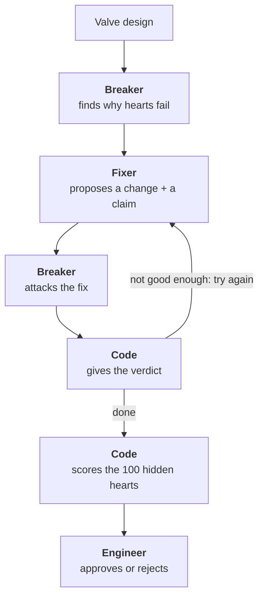

# Valvular

**Two AI agents stress-test a heart valve design on 500 synthetic hearts.** One finds why the valve fails, the other proposes a fix, and code checks every number before an engineer signs off.

## The problem

A transcatheter aortic valve comes in a few sizes. Each size fits a range of patients' aortic roots. Before a design goes further, a valve engineer needs to know:

- How many patients does our size range fit?
- Where does it fail, and why?
- What change would fix it, and what new risk does that change bring?

Answering this today means slow manual analysis across many anatomies.

## What Valvular does

| | |
|---|---|
| **Input** | A valve design (a set of sizes), plus optional limits like "no more than 4 sizes" |
| **Test hearts** | 500 synthetic aortic roots from a published shape model. 400 for the agents, 100 hidden |
| **Output** | Fit, risk or no fit for every heart, why hearts fail, a proposed fix with a verdict, and the engineer's approval |

**Example from our recorded run:**

| Step | Fit | What happened |
|---|---|---|
| Starting valve (23, 25, 27 mm) | 59.75% | 68 hearts at risk, 93 with no fit |
| Fix 1: add a 28 mm size | 72% | 8 new at-risk hearts. The Breaker's attack **broke** it |
| Fix 2: add a 19 mm size | 81.25% | 0 new at-risk hearts. The claim **held up** under attack |

## How it works



The loop stops when a fix stops improving things, the budget runs out, or there's no valid fix left. Demo mode allows 2 fix rounds.

### Who does what

| Role | Does | Can't do |
|---|---|---|
| **Breaker** (agent) | Investigates failures: groups them, compares measurements, inspects single hearts. Then attacks each fix, e.g. "shift every measurement by 1 mm" | See hidden hearts, edit the design, invent numbers |
| **Fixer** (agent) | Reads the findings, edits the design, submits a fix with a checkable claim like "fit ≥ 72%" | See hidden hearts, bypass limits, approve anything |
| **Code** | All fit maths, every tool result, the loop, budgets, stop rules and verdicts | Choose what to investigate or propose |
| **Engineer** | The final call: approve, or reject with a note that sends it back to the Fixer | |

### The tools

The agents run on **Gemini** with function calling. They choose which tool to call; each tool is plain code that returns real numbers on the 400 dev hearts.

| Tool | Used by | Returns |
|---|---|---|
| `evaluate_design` | Both | Fit, risk and no-fit counts |
| `group_failures` | Breaker | Failures grouped by rule, size or measurement band |
| `profile_group` | Breaker | How a group's measurements differ from the rest |
| `inspect_heart` | Breaker | One heart's measurements, size and failure reasons |
| `what_if` | Breaker | Whether a change would fix specific hearts |
| `stress_test` | Breaker | Results after an attack. The Breaker must first say what result would disprove its idea |
| `report_findings` | Breaker | Validated findings, ending its turn |
| `edit_design` | Fixer | The new design, its comparison with the old one, and which limits pass |
| `submit_proposal` | Fixer | The fix with a structured claim, ending its turn |

### Verdicts

Agents never grade themselves. After the attacks, code gives each fix one verdict:

| Verdict | Meaning |
|---|---|
| Supported under conditions | The claim held on the dev hearts and under every attack |
| Context dependent | It held on the dev hearts but broke under an attack |
| Contradicted | It failed on the dev hearts |
| Inconclusive | No attack finished |
| Invalid experiment | Bad evidence or an invalid design |

Every verdict also lists what it doesn't show, such as "dev hearts only".

### Hidden hearts

- The agents tune their fix on 400 hearts. A fix can look great on hearts it was tuned on and still fail on new ones.
- 100 hearts are hidden from every agent and tool. Only code scores them, after the loop, so the agents can't game them.
- Code scores 3 non-AI baselines on the same 100: no change, add a larger size, and brute force. If brute force wins, the Results page shows it.
- The screen shows how many times the hidden hearts have been scored.

## Why it's agentic

- **The agents choose their next step** from what they just found. It's not a fixed script.
- **They work over many steps:** up to 8 model steps and 16 tool calls per turn, often several calls at once.
- **Two agents with opposite goals** check each other. One proposes, the other attacks.
- **Ideas are tested, not asserted.** Every attack states what would disprove it, and "it held up" is a valid result.
- **They replan** when the valve or the limits change.
- **Why not just brute force?** It's better at maximising one score, and we show that openly. Agents explain why hearts fail, answer attacks, handle new limits and explain the trade-off.

## Safety

- **No invented numbers.** Every tool result gets an evidence ID. If an agent writes a number that isn't in its cited evidence, code rejects it.
- **No self-grading.** Code gives every verdict.
- **Hidden hearts stay hidden.** No tool can read them.
- **A human signs off.** The backend refuses to export a design without the engineer's decision.
- **Hard budgets.** Each agent turn has limits on steps, tool calls and time, and code logs why a run stopped.
- **Fit only.** No medical safety claims, synthetic hearts only, and placeholder fit rules are labelled `demo-assumption`.

## The demo

The workspace plays a real recorded Gemini run through our live code, so every number is recalculated by code. A live run takes about 8 minutes, so the recording keeps the demo fast. Live mode is at `/?mode=live`.

## Data and limits

- **Data:** 500 synthetic stenotic hearts from the [4TU dataset](https://data.4tu.nl/datasets/3f6a3788-96e6-4b81-b37b-f07eeec85965) (Verstraeten et al. 2023, CC BY 4.0). No real patient data.
- **Limits:** all hearts come from one generator, so the hidden score tests our method, not real-world performance. There are no coronaries or calcium. Brute force can match the agents on coverage alone.

## Stack

Next.js and TypeScript · React Three Fiber (3D heart) · Gemini function calling · zod contracts · Playwright tests (written before the code for every requirement)

## Run it locally

```bash
npm ci
npm run build && npm start   # open http://localhost:3000
```

- **Live mode:** put `GEMINI_API_KEY=...` in `.env.local`, then open `/?mode=live`. The default demo needs no key.
- **Tests:** `npm run test:e2e`. `npm run verify` also checks the raw dataset; set `VALVULAR_DATA_ZIP` to the downloaded 4TU zip.
